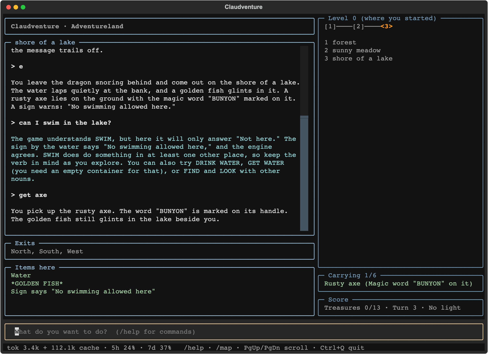

# Claudventure

**Play the 1978 Scott Adams adventures in plain English, with Claude as your narrator.**

The original games understand exactly two words, `VERB NOUN`, of which only the first three letters count. Claudventure puts Claude between you and the untouched original engine. You write what you want to do, Claude turns it into commands the parser understands, the real engine runs them, and Claude tells you what happened. It also answers your questions and gives graded hints when you are stuck.

The engine stays the only authority on what happens in the game. Claude does not decide outcomes.



*(A real session in the full-screen interface: on the left the story, under the name of the place, with the narrator's answers to questions in cyan, then the exits and the items here; on the right the map of the current level, what you carry and the score.)*

Claude translates whatever you write, and answers when you talk to it rather than to the game:

```
> I want to chuck the axe into the water
You hurl the axe at the water, but nothing happens, and the axe lands on the shore
beside you. Meanwhile the fish slips away from you: "Fish have escaped back to the
lake." The *GOLDEN FISH* is lying on the shore again, and your hands are empty.

> dance a little jig
The game has no verb for dancing. The closest ones it knows are JUMP, which makes you
hop about, and WAVE (also TOUCH, KICK, HIT and a few others in that group). If you
want to jump, just say so and I'll send it.

> go north
You wade north into a quick-sand bog. The ground sucks at your feet, and no way out
is visible. A *Small statue of a BLUE OX* sits here in the muck.

> I'm stuck, any hint?
Gentle nudge: no exits are listed, but the game knows a few verbs that describe
moving through water or muck. Think about what you've seen on the shore you just came
from, and about how heavy you are right now.
```

*(From a real session, lightly trimmed. Out-of-game answers such as hints and help appear in a different colour.)*

## Features

- **Full-screen interface.** On the left, the story scrolls (PgUp/PgDn) under the name of the place you are in, with the exits and the items here below it; panels on the right always show the map of the level you are on, your inventory and the score. Input has a history (Up/Down). `--plain` gives the classic scrolling text instead.

- **Natural language in, original game underneath.** "Take the axe and go north" becomes `GET AXE` followed by `NORTH`. "Pick up", "grab" and "take" all become `GET`. Compound sentences are split into several commands.
- **The right verb, every time.** Claude checks every command against the game's own vocabulary before it is sent. A word the parser does not know is never sent and never costs a turn. Claude tells you which verbs the game understands instead.
- **Grounded narration.** Claude rewrites the terse 1978 output as lively second-person prose, but only from facts the engine reported. The exits and visible items under each description come straight from the engine state, so they can never be invented.
- **Graded hints.** The first time you ask, you get a nudge. Ask again about the same problem and the hint names the object or place. Only on the third request, or if you ask for the solution outright, do you get the exact commands. When translating, Claude is told never to add solution steps you did not ask for.
- **A map of where you have been.** `/map` draws the places you have visited as ASCII, one level per height, with what you last saw in each place, the exits you have not explored yet and the magic ways you found (`CLIMB TREE`, `SAY AWAY`...):

  ```
  Level 0 (where you started)
                  <4>
                   │
    [1]────[2]────[3]

  Places (you are at <4>; ^ v ↕ = a way up / down):
   1  forest  —  Trees  (N,S,W lead back here)
   2  sunny meadow  —  Large sleeping dragon, Sign here says "In many cases mud is good…
   3  shore of a lake  —  Water, *GOLDEN FISH*, Rusty axe (Magic word "BUNYON" on it)…
   4  quick-sand bog  —  *Small statue of a BLUE OX*
  ```
- **Undo, save, load.** `/undo` takes back your last message, even after a fatal mistake. `/save` and `/load` keep named saves, and quitting saves automatically.
- **Token and quota meter.** The status line shows the tokens used and your Claude subscription quota (5-hour and weekly windows). `/usage` gives the breakdown.
- **All 18 games.** Each game file is decoded into a complete guide for the narrator: vocabulary with synonyms, map, items, and every rule of the game logic in readable form, including the original authors' comments.
- **Verified solutions for 13 of the 18 games.** Each one is played to the end on the real engine over hundreds of random seeds; the narrator keeps it secret and uses it only for graded hints. Where a solution sometimes fails, it is because of the game's own random hazards, and the solution's notes say so (see [The games](#the-games)).
- **Plain game commands skip the interpretation step.** Typing `n`, `i`, `get axe` or `climb tree` sends the command straight to the engine, and Claude only narrates the outcome: one request instead of two. Use `--always-interpret` to let Claude interpret everything.
- **No API key.** Claudventure drives Claude Code in non-interactive mode, so it runs on your Claude subscription.

## How it works

```
 you ──► claudventure (Python, terminal app)
           │  1. your message + current game state
           ▼
         Claude  (persistent `claude -p` session, stream-json, no tools)
           │  2. <cmd>GET AXE</cmd><cmd>NORTH</cmd>
           ▼
         claudventure checks the words against the game vocabulary
           │  3. runs the commands one by one
           ▼
         ScottFree engine, headless mode (-j) ──► text + JSON state per turn
           │  4. engine output + room view + state
           ▼
         Claude narrates ──► streamed to your terminal
```

- **Engine.** [ScottFree](src/README) is the 1990s GPL interpreter for the Scott Adams TRS-80 data files. It got a small patch: with `-j` it reads stdin and writes stdout instead of drawing with curses, prints a JSON snapshot of the game state every turn, and accepts `#save`, `#load` and `#look` from the front end. Without `-j` it works exactly as before (`./play.sh`). One bug is fixed in both modes: ScottFree's random numbers only came in multiples of 4, so a 1% event in a game happened 4% of the time and a 10% event 12% of the time.
- **Game knowledge.** `claudventure/scott.py` parses the `.dat` files and decodes the action table into rules such as `A64 CHOP TREE: IF Cypress tree is here AND carrying Rusty axe ... THEN ...`. The decoded guide and the walkthrough go into the narrator's system prompt. They are cached, so every turn after the first reads them cheaply.
- **Narrator.** `claudventure/narrator.md` sets the rules: translate intent, not the solution; never invent facts; quote signs and clues exactly; stay inside the story; put hints in asides, graded.
- **Isolation.** The Claude session runs with no tools, no MCP servers, none of your user settings and no `CLAUDE.md`, from an empty working directory. It can only talk.

## Requirements

- macOS or Linux, with a C compiler and curses (`gcc`, `ncurses`)
- Python 3.9 or newer, plus [Textual](https://textual.textualize.io/) for the full-screen interface (`--plain` needs nothing beyond the standard library)
- [Claude Code](https://claude.com/claude-code), installed and logged in. Developed with version 2.1.

## Getting started

```sh
git clone https://github.com/marcogherardi/claudventure.git && cd claudventure
make -C src                               # builds src/ScottCurses
python3 -m pip install -r requirements.txt  # Textual, for the full-screen interface
```

The game files are not included, because the games are still copyrighted by Scott Adams (see [Credits](#credits-and-licences)). Get the *Scott Adams Collection* in ScottFree / TRS-80 `.dat` format, for example from the [Interactive Fiction Archive](https://www.ifarchive.org/indexes/if-archive/scott-adams/), and put the `.dat` files in `games/` (see [games/README.md](games/README.md)).

```sh
./claudventure.sh                   # Adventureland
./claudventure.sh --list            # all the games
./claudventure.sh adv05             # The Count
./claudventure.sh --load autosave   # pick up where you left off
./claudventure.sh --model haiku     # faster and lighter, less accurate
./claudventure.sh --always-interpret  # let Claude interpret even plain commands like 'n'
./claudventure.sh --plain           # scrolling text instead of the panels
./play.sh                           # the original game, no AI
```

| In-game command | |
|---|---|
| `/undo` | take back your last action |
| `/save [name]`, `/load [name]`, `/saves` | named saves |
| `/new` | start over |
| `/map` | map of the places you have visited |
| `/usage` | tokens, estimated cost, subscription quota |
| PgUp / PgDn, Up / Down, Ctrl+Q | scroll the story, recall earlier input, quit (full-screen mode) |
| `/quit` | leave (the game is saved as `autosave`) |

A valid one- or two-word game command (`e`, `get axe`) goes straight to the game and Claude narrates the result. Anything else goes to the narrator, whether it is an action ("light the lamp and go down"), a question ("what was written on that sign?") or a cry for help ("I'm stuck").

## Choosing a model

Sonnet is the default. Both models were run through the same test script (`claudventure/tests/`):

| | Sonnet | Haiku |
|---|---|---|
| Time per message | about 3 s | about 2.4 s |
| Translating commands | very good | good |
| Staying faithful to the game | very good | invented unseen places and gave warnings the game never gives |
| Hints | graded as asked | gave away the treasure room at the first question |

Use `--model` or the `CLAUDVENTURE_MODEL` variable to change it, and `--effort` or `CLAUDVENTURE_EFFORT` to change the reasoning effort (default `low`).

## The games

| File | Game | File | Game |
|---|---|---|---|
| adv01 | Adventureland | adv10 | Savage Island, Part I |
| adv02 | Pirate Adventure | adv11 | Savage Island, Part II |
| adv03 | Secret Mission | adv12 | The Golden Voyage |
| adv04 | Voodoo Castle | adv13 | Sorcerer of Claymorgue Castle |
| adv05 | The Count | adv14a | Return to Pirate's Isle |
| adv06 | Strange Odyssey | adv14b | Buckaroo Banzai |
| adv07 | Mystery Fun House | quest1 | Questprobe 1: The Hulk |
| adv08 | Pyramid of Doom | quest2 | Questprobe 2: Spiderman |
| adv09 | Ghost Town | sampler1 | Adventureland (sampler) |

Verified solutions, with how often they win on the real engine (the rest of the time the game's own random hazards strike, as the notes in each file explain):

| Game | Wins | Game | Wins |
|---|---|---|---|
| sampler1 Adventureland (sampler) | 100% | adv07 Mystery Fun House | 100% |
| adv01 Adventureland | 72% | adv08 Pyramid of Doom | 78% |
| adv02 Pirate Adventure | 100% | adv09 Ghost Town | 100% |
| adv03 Secret Mission | 89% | adv10 Savage Island, Part I | 73% |
| adv04 Voodoo Castle | 100% | adv11 Savage Island, Part II | 100% |
| adv05 The Count | 100% | adv12 The Golden Voyage | 50% |
| adv06 Strange Odyssey | 69% | adv13 Sorcerer of Claymorgue Castle | 63% |

Savage Island, Part I ends with a password for Part II: 474 with this solution, 123 if you also got the pirate's bandanna. Only 123 can win Part II, but the game does not check where the password came from.

For the other games (adv14a, adv14b, quest1, quest2) Claude works out its hints from the decoded game logic. To add a solution, write a command list in `claudventure/walkthroughs/<game>.txt` and check it on the real engine:

```sh
python3 claudventure/walkthrough.py games/adv14a.dat claudventure/walkthroughs/adv14a.txt --seeds 100 --map
```

A line is a game command; `? CMD` is needed only sometimes; `if here "X": CMD` runs only when X is in the room (also `carrying`, `said` for the last message, `not`, `and`), which handles random events; `# win: <text>` names the winning message of a game without treasures. `--map` draws the map of the places visited.

## Project layout

```
claudventure.sh             launcher
play.sh                     the original game in curses, no AI
claudventure/
  app.py                    the game session (Claude, command checking, undo, saves, usage) and --plain mode
  tui.py                    full-screen interface (Textual)
  automap.py                ASCII map of the visited places
  engine.py                 drives the headless engine over pipes
  scott.py                  .dat reader and game-guide generator (python3 claudventure/scott.py guide games/adv01.dat)
  narrator.md               the narrator's rules (system prompt template)
  walkthroughs/             verified solutions (13 games)
  walkthrough.py            plays a walkthrough on the real engine and reports the result
  tests/                    scripted sessions used to compare models
src/                        ScottFree 1.14 with the headless patch
games/                      the .dat game files (not included)
saves/, logs/               created at run time; logs include the raw engine output
```

## Credits and licences

- **The games** are © Scott Adams, 1978-84. They were distributed as shareware ("freely downloaded and enjoyed"), but they remain copyrighted and are not part of this repository.
- **ScottFree** is © 1993-95 Swansea University Computer Society (Alan Cox), under the GNU GPL version 2. The headless mode and the build fixes in `src/ScottCurses.c` are under the same licence.
- **Claudventure** is built on [Claude Code](https://claude.com/claude-code) by Anthropic.
